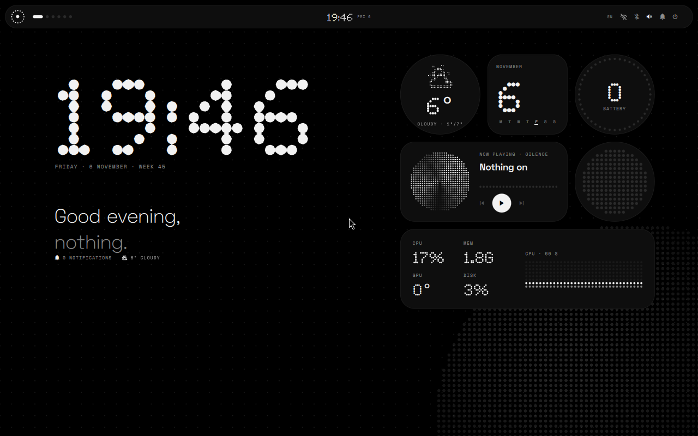
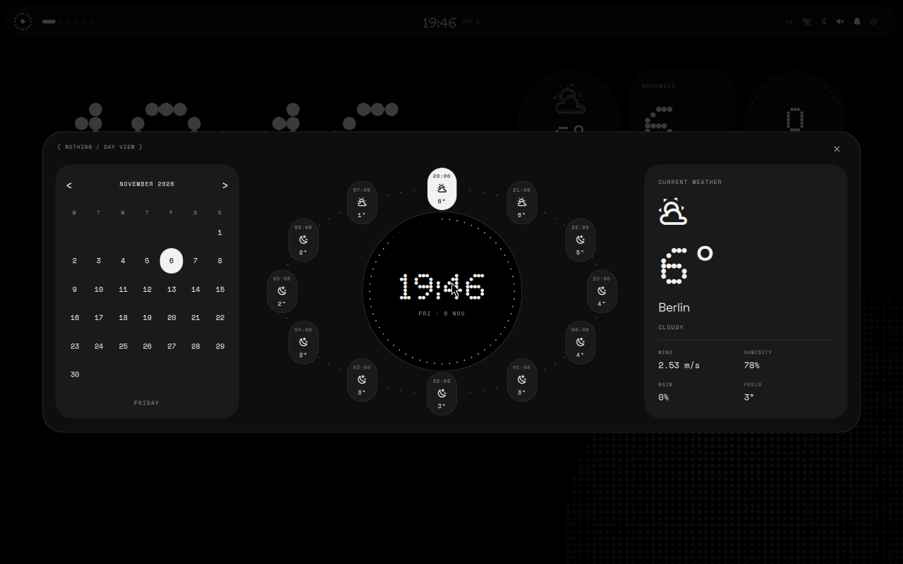

<div align="center">

# NOTHING / NIRI

**A monochrome desktop shell for Arch Linux + Niri.**

Nothing-inspired widgets. A top bar. Dot-matrix type. No red accents.

[Install](INSTALL-NOTHING.md) · [Русский](README.ru.md) · [Report a bug](https://github.com/dashatuchka/nothing-os-ricing/issues)

</div>



Nothing / Niri brings the visual language of [Glyph](https://github.com/Nebelung-cloud/glyph-rice) to the Niri scrolling compositor. It combines Glyph's desktop and widgets with a calendar and orbital weather view inspired by Serpentinum.

An unofficial fan project, not affiliated with Nothing Technology Limited.

## Who is this for?

For people who already run **Arch Linux and Niri** and want a black-and-white desktop with large dotted clocks, music controls and home-screen widgets.

Start with a working Niri session, internet, sound and an existing `~/.config/niri/config.kdl`. The installer adapts your configuration. Hyprland and Serpentinum are not required.

This is a desktop shell, not an Arch installer or a complete distribution. Your login screen, display setup, keyboard layouts and installed apps stay in place.

## What's included

| Component | Features |
| --- | --- |
| Top bar | Workspaces, clock, keyboard layout, network, audio and battery |
| Home screen | Large clock, greeting, dot grid and halftone background |
| Widgets | Weather, calendar, battery, music, Cava and system statistics |
| Calendar | Month grid, current weather and an orbital hourly forecast |
| Control center | Volume, brightness, widget switches, light/dark mode and DND |
| Launcher | Application search, window selection and calculator mode |
| Notifications | History and Glyph-style edge effects |
| Dashboard | Clock, weather, performance, network and media panels |
| Typography | Ndot support; bundled Doto, Space Grotesk and Space Mono |

Niri manages windows. Swaylock locks the screen. Network, Bluetooth and detailed audio controls open the corresponding system apps.



Actual screenshots from a nested Niri session. The location and device metrics shown are test data from that environment.

## Install

**Use `scripts/install-nothing.py`.** Other installers in this repository belong to earlier versions.

Install dependencies on Arch:

```bash
sudo pacman -Syu --needed git quickshell python fontconfig ttf-jetbrains-mono-nerd curl cava brightnessctl swaylock pavucontrol network-manager-applet blueman
```

Download the project:

```bash
git clone https://github.com/dashatuchka/nothing-os-ricing.git
cd nothing-os-ricing
```

Prepare and validate without changing the current session:

```bash
python3 scripts/install-nothing.py --output "/tmp/nothing-preview-$(date +%s)"
```

This uses bundled **Doto**, the dot font used by the Glyph reference. For Ndot, see [Fonts](#fonts) before applying.

After a successful preview, save your work, **log out of Niri**, switch to a TTY with `Ctrl+Alt+F3`, log in and return to the project directory:

```bash
python3 scripts/install-nothing.py --apply
niri validate
```

The installer must print `Installed independent Nothing shell` and a backup path. **Preview alone does not install the shell.** Save the printed `Rollback:` command. After successful validation, reboot and enter your normal Niri session.

Run the Python installer without `sudo`. See the [full guide](INSTALL-NOTHING.md) for installation and rollback details.

### What changes?

The installer backs up replaced paths, installs `~/.config/quickshell/nothing`, creates its own settings/state, and edits Niri's direct autostart entries and four application/panel bindings.

It replaces direct startup of Serpentinum, Waybar, Mako, swaybg and other Quickshell configurations. The new shell draws its own background. Previous programs and wallpaper files remain installed. Separate systemd user services and XDG autostart entries are not changed.

`XDG_CONFIG_HOME` and `XDG_STATE_HOME` are respected. The installer expects one `binds` block and a single-line `Mod+D` binding. It refuses ambiguous configs or conflicts with `Mod+A`, `Mod+N` and `Mod+Shift+D`.

## Controls

| Shortcut | Action |
| --- | --- |
| `Super+D` | Applications |
| `Super+A` | Control center and widget switches |
| `Super+N` | Calendar and orbital weather |
| `Super+Shift+D` | Dashboard |

Click the bar's mark, status icons or clock for the same panels. Weather/calendar widgets open the calendar view. Other Niri shortcuts remain yours.

### Weather

Edit the `location` object in `~/.config/nothing-niri/settings.json`, keeping the other fields. For example:

```json
"location": {
  "latitude": 52.52,
  "longitude": 13.40,
  "city": "Berlin",
  "timezone": "Europe/Berlin"
}
```

Log out and back in after editing. Weather comes from Open-Meteo. Without configured coordinates, the service attempts an IP-based lookup. The installer can import an existing Serpentinum location. Paths follow `XDG_CONFIG_HOME` when set.

### Fonts

Default: bundled **Doto**. For a local Ndot file, add `--dot-font /path/to/Ndot57-Regular.otf` to both preview and apply commands:

```bash
python3 scripts/install-nothing.py --apply --dot-font "$HOME/Downloads/Ndot57-Regular.otf"
```

Alternatively, `--download-ndot` fetches the inspected Ndot 57 file from a [third-party font repository](https://github.com/xeji01/nothingfont), with SHA-256 and font-family verification. Ndot is not bundled in Git. When installed, compare it with Doto in the control center. Small labels use readable fonts.

### Music and Cava

The music card follows MPRIS players such as Spotify and supported browsers. Cava turns system audio into a dot-matrix visualizer. Toggle widgets with `Super+A`.

## Rollback and updates

To restore the previous session, log out, enter a TTY and run the `--restore` command printed during installation, then `niri validate` and reboot. Rollback also saves the files it replaces.

`git pull` updates the checkout; installed files are copies. There is no in-place updater yet. Restore the previous session before reapplying a newer version, or follow explicit update instructions.

## Troubleshooting

**Desktop unchanged:** make sure you ran `--apply`, not only `--output`. Check the installed launcher:

```bash
ls -l "${XDG_CONFIG_HOME:-$HOME/.config}/quickshell/nothing/launch.py"
```

**Shell fails to start:** run it manually from your Niri terminal and read the error:

```bash
python3 "${XDG_CONFIG_HOME:-$HOME/.config}/quickshell/nothing/launch.py"
```

**Two bars or old wallpaper:** check the previous shell's systemd user services and XDG autostart. Avoid running two notification servers at once.

[Open an issue](https://github.com/dashatuchka/nothing-os-ricing/issues) with Niri/Quickshell versions, the exact command and error, and a screenshot when relevant. Remove personal locations and credentials from attached files.

## Project status

Used on an Arch + Niri laptop. Runtime smoke tests also ran in a nested Arch session with Niri 26.04, Quickshell 0.3.2 and Qt 6.12. Audio, brightness and Bluetooth support depend on your system services. Other distributions have not been validated.

Run the dependency-free Python checks:

```bash
python3 -m unittest discover -s tests -v
```

| Path | Purpose |
| --- | --- |
| `config/quickshell/nothing/` | Current shell and native Niri event bridge |
| `scripts/install-nothing.py` | Current installer and rollback |
| `tests/` | Event, migration, palette and rollback checks |
| `screenshots/` | Runtime screenshots |
| Other `config/` folders and `presets/serpantinum/` | Earlier experiments, not required |

## Credits and license

- [Nebelung-cloud / Glyph](https://github.com/Nebelung-cloud/glyph-rice): original visual design and the reused/adapted desktop, bar, widget and service components.
- [Serpentinum](https://github.com/ilyamiro/serpantinum): inspiration for the calendar and orbital forecast composition.
- [Niri](https://github.com/niri-wm/niri), [Quickshell](https://quickshell.org/) and [Open-Meteo](https://open-meteo.com/): compositor, shell framework and weather.
- Doto, Space Grotesk and Space Mono authors: bundled fonts under the [SIL Open Font License](config/quickshell/nothing/fonts/OFL.txt).

Current shell: [GPL-3.0](LICENSE). See [upstream provenance](config/quickshell/nothing/UPSTREAM.md) for the source snapshot and adaptation details. The legacy `style-serpantinum.py` patcher carries [AGPL-3.0-or-later](LICENSES/AGPL-3.0.md). Ndot retains its own rights and is fetched separately.
