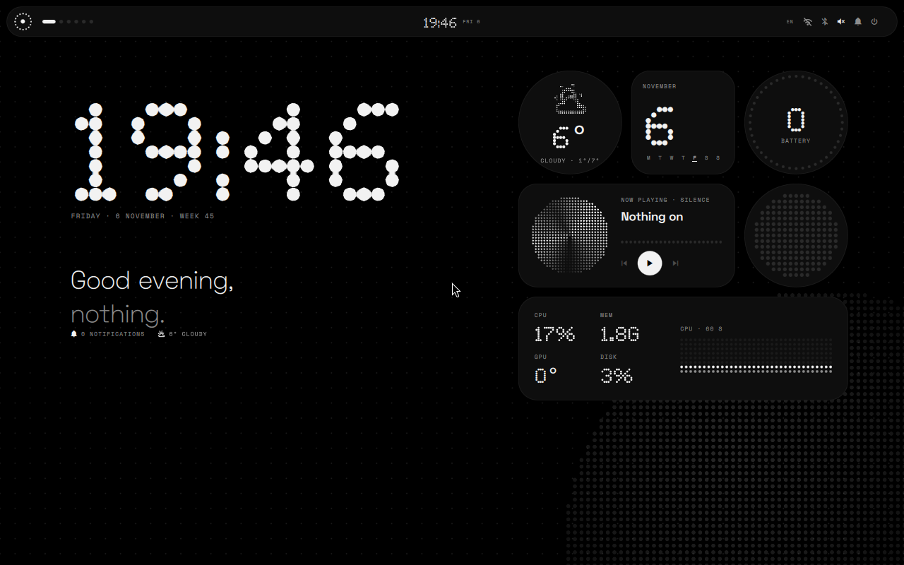
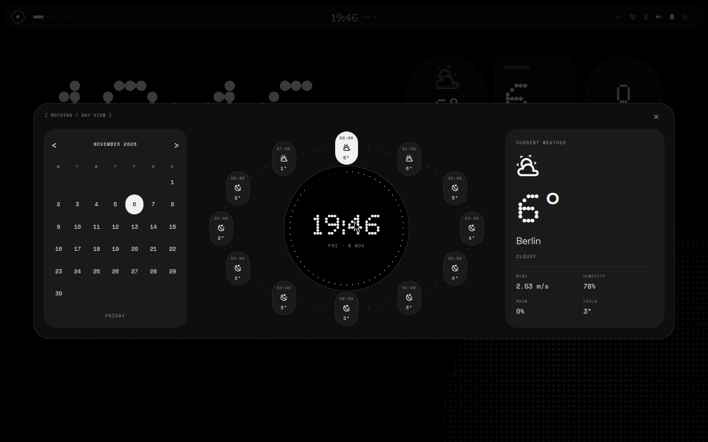

<div align="center">

# NOTHING / NIRI

**Чёрно-белая оболочка для Arch Linux + Niri.**

Виджеты в стиле Nothing, верхний бар, точечная типографика — без красных акцентов.

[Установка](INSTALL-NOTHING.md) · [English](README.md) · [Сообщить об ошибке](https://github.com/dashatuchka/nothing-os-ricing/issues)

</div>



Адаптация визуального языка [Glyph](https://github.com/Nebelung-cloud/glyph-rice) для скроллингового композитора Niri. Домашний экран и виджеты Glyph дополнены календарём и орбитальным прогнозом по мотивам Serpentinum.

Неофициальный фанатский проект, не связанный с Nothing Technology Limited.

## Кому подойдёт

Тем, у кого **уже установлен Arch Linux и работает Niri**, а хочется монохромный рабочий стол с крупными часами, погодой, музыкой и виджетами.

Нужны рабочая сессия Niri, интернет, звук и существующий `~/.config/niri/config.kdl`. Hyprland и Serpentinum для работы не требуются. Это оболочка, а не дистрибутив и не установщик Arch: гритер, монитор, раскладки и приложения остаются твоими.

## Что внутри

| Компонент | Возможности |
| --- | --- |
| Верхний бар | Рабочие столы, часы, раскладка, сеть, звук и батарея |
| Домашний экран | Крупные часы, приветствие, сетка точек и полутоновый фон |
| Виджеты | Погода, календарь, батарея, музыка, Cava и системные показатели |
| Календарь | Месяц, текущая погода и почасовой прогноз по орбите |
| Центр управления | Звук, яркость, состав виджетов, светлая/тёмная тема и DND |
| Лаунчер | Поиск приложений, выбор окна, калькулятор |
| Уведомления | История и световые эффекты Glyph по краям экрана |
| Дашборд | Часы, погода, производительность, сеть и музыка |
| Шрифты | Поддержка Ndot; встроенные Doto, Space Grotesk и Space Mono |

За окна отвечает Niri, за блокировку — Swaylock. Кнопки сети, Bluetooth и расширенных настроек звука открывают соответствующие системные приложения.



Это реальные снимки работающей оболочки в тестовой сессии Niri. На них тестовый город и показатели контейнера.

## Как установить

[Полная инструкция →](INSTALL-NOTHING.md)

Основной установщик — **`scripts/install-nothing.py`**. Другие скрипты относятся к ранним вариантам оформления.

Установка состоит из двух разных шагов:

1. `--output` подготавливает файлы и проверяет конфиг, ничего не устанавливая.
2. `--apply` создаёт резервную копию и устанавливает оболочку. Выполняется из TTY после выхода из Niri, без `sudo`.

После успешной установки скрипт печатает `Installed independent Nothing shell`, путь бэкапа и команду отката. Сохрани её.

Установщик заменяет прямой автозапуск прежней оболочки, панели и обоев в Niri. Старые программы и файлы обоев не удаляются. Службы systemd user и XDG autostart отдельно не меняются. Пути учитывают `XDG_CONFIG_HOME` и `XDG_STATE_HOME`.

## Управление

| Клавиши | Действие |
| --- | --- |
| `Super+D` | Приложения |
| `Super+A` | Центр управления и переключатели виджетов |
| `Super+N` | Календарь и орбитальный прогноз |
| `Super+Shift+D` | Дашборд |

`Super` — обычно клавиша Windows. Знак, статусы и часы в баре открывают соответствующие панели. Остальные бинды Niri сохраняются.

## Что настроить под себя

**Виджеты:** `Super+A` → включи погоду, календарь, батарею, плеер, Cava или системную карточку. Cava — визуализатор воспроизводимого звука в виде матрицы точек. Музыкальная карточка работает с MPRIS-плеерами, например Spotify.

**Город:** поле `location` в `~/.config/nothing-niri/settings.json`. Погода берётся из Open-Meteo. Без координат оболочка пробует определить место по IP. После изменения файла выйди из сессии и войди снова. Пример — в [инструкции](INSTALL-NOTHING.md#погода).

**Шрифт:** по умолчанию используется Doto, как в оригинальном Glyph. При установке можно передать свой Ndot через `--dot-font` или скачать проверенный Ndot 57 через `--download-ndot`. Ndot не хранится в Git. Крупные цифры используют точечный шрифт, подписи — обычный читаемый.

**Тема и уведомления:** светлая/тёмная тема и DND доступны в центре управления. Интерфейс остаётся чёрно-белым.

## Откат и обновления

Для отката выйди из Niri, перейди в TTY и выполни напечатанную установщиком команду `--restore`. Затем `niri validate` и перезагрузка. Текущие файлы при откате тоже сохраняются.

Установленные файлы — копии. `git pull` обновляет только репозиторий. Автоматического обновления установленной оболочки пока нет: перед повторной установкой новой версии восстанови предыдущую сессию либо следуй отдельной инструкции обновления.

## Если что-то не работает

Если оформление не изменилось, проверь, что выполнен **`--apply`**, а не только `--output`.

Для диагностики запуска из терминала Niri:

```bash
python3 "${XDG_CONFIG_HOME:-$HOME/.config}/quickshell/nothing/launch.py"
```

Если одновременно появились два бара, проверь отдельные службы и автозапуск прежней оболочки.

Для помощи [создай issue](https://github.com/dashatuchka/nothing-os-ricing/issues): версии Niri и Quickshell, команда, полный текст ошибки и скриншот при необходимости. Не прикладывай пароли, токены и личные координаты.

## Статус

Оболочка используется на ноутбуке с Arch + Niri. Дополнительно проверена во вложенной Arch-сессии с Niri 26.04, Quickshell 0.3.2 и Qt 6.12. Звук, яркость и Bluetooth зависят от установленных системных служб. Другие дистрибутивы не проверены.

Проверки кода:

```bash
python3 -m unittest discover -s tests -v
```

Исходники оболочки находятся в `config/quickshell/nothing/`, установщик — в `scripts/install-nothing.py`. Остальные конфиги Waybar и `presets/serpantinum/` — ранние эксперименты, для новой оболочки они не нужны.

## Авторы и лицензии

- [Nebelung-cloud / Glyph](https://github.com/Nebelung-cloud/glyph-rice) — исходный визуальный дизайн и переиспользованные компоненты рабочего стола, бара, виджетов и сервисов.
- [Serpentinum](https://github.com/ilyamiro/serpantinum) — идея компоновки календаря и орбитального прогноза.
- [Niri](https://github.com/niri-wm/niri), [Quickshell](https://quickshell.org/) и [Open-Meteo](https://open-meteo.com/) — композитор, основа оболочки и погода.
- Авторы Doto, Space Grotesk и Space Mono — встроенные шрифты под [SIL OFL](config/quickshell/nothing/fonts/OFL.txt).

Основная оболочка — [GPL-3.0](LICENSE). [Происхождение компонентов](config/quickshell/nothing/UPSTREAM.md) сохранено. Старый патчер `style-serpantinum.py` — [AGPL-3.0-or-later](LICENSES/AGPL-3.0.md). Права на Ndot сохраняются за его правообладателями; файл загружается отдельно.
